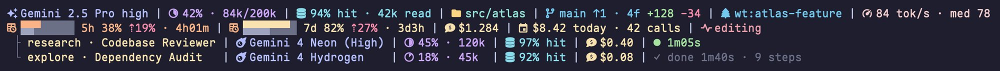
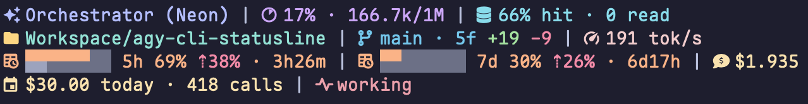

# agy-cli-statusline

A customizable status line and live-preview terminal editor for Antigravity CLI (`agy`).


**English** · [简体中文](./README.zh-CN.md)

## Preview


*Full layout with context ring, cache hit ratio, Git diff stats, worktree, TPS, 5h/7d quota pace bars, session & daily spend, and aligned subagent tree.*


*Live `agy` session automatically wrapping overflowing rows onto additional lines at full fidelity.*

## Features

- **Live-preview TUI editor**: bilingual (English / 简体中文), keyboard-driven, powered by the exact same renderer `agy` uses.
- **Rich telemetry**: 18 built-in segments covering model, context ring/bar, prompt cache, Git diff stats, 5h/7d quota pace, TPS, session & daily spend, and an aligned subagent tree.
- **Presets & themes**: 13 presets (8 from CCometixLine + 5 built-in), 18 color palettes, Nerd / Unicode / ASCII icons, and hybrid multi-row layouts with full-fidelity per-row narrow-terminal wrapping.
- **Safe & standalone**: zero runtime dependencies; registers into `~/.gemini/antigravity-cli/settings.json` with automatic backup if replacing an existing status line.

## Quick Start

Requires **Node.js 22+** and **Antigravity CLI** on **macOS** or **Linux**.

### Interactive editor (recommended)

```sh
npx agy-cli-statusline
# Or from a local checkout:
node bin/agy-cli-statusline.mjs
```

Choose **English** or **简体中文**, customize your preset, theme, and segments with live preview, then press `Ctrl+S` and start a new `agy` session. First launch registers the footer automatically (prompting and backing up `settings.json` if another `statusLine` is already configured).

### Configure inside `agy` (plugin)

```sh
agy plugin install https://github.com/Caph-dev/agy-cli-statusline
# Or from a local checkout:
agy plugin install .
```

In `agy`, type `/agy-cli-statusline-setup`, press `Tab` to complete to `/agy-cli-statusline:agy-cli-statusline-setup` (required in agy 1.5.18), and describe the preset or segments you want. Restart `agy` if the footer does not refresh immediately.

### Scriptable CLI

```sh
agy-cli-statusline configure --show
agy-cli-statusline configure --preset dashboard --color-depth 256
agy-cli-statusline configure --preset studio --segments "model,dir,git / context,cache,cost"
agy-cli-statusline configure --preset studio --layout 3,2 --segments "model,dir,git,context,cost"
agy-cli-statusline preview --preset cometix
```

Use `/` inside `--segments` for forced line breaks (and optional `|` for left/right alignment within a row), or pass `--layout flat | preset | L[:R],L[:R]...`. Run `agy-cli-statusline --help` for all options, and add `--replace` when replacing an existing custom status line.

> Preferences and a self-contained renderer copy live in `~/.gemini/antigravity-cli/agy-cli-statusline/`, so the footer keeps working even if npm's cache is cleared or the plugin is uninstalled. Switch `icons` to `unicode` or `ascii` if your terminal does not use a Nerd Font.

## Segments

| Segment | Description |
| :--- | :--- |
| `model` | Active model display name, ID, and reasoning effort. |
| `dir` | Current workspace directory (`auto`, `name`, `parent`, `tilde`, `short`, or `full`). |
| `git` | Branch, short HEAD SHA, dirty / ahead / behind markers, and optional changed-file & `+added -deleted` diff stats. |
| `worktree` | Linked Git worktree name. |
| `vcs` | Version-control system type (when reported by `agy`). |
| `context` | Context window usage; defaults to a dynamic proportional ring (`gauge`, turning yellow ≥70% and red ≥90%) and also supports `bar` / `text` widgets and token counts (`% · used/total`). |
| `cache` | Prompt cache warm/cold TTL countdown, session hit ratio (`{hit}% hit`), misses, miss cause, and estimated rewarm cost; supports `text` / `bar` / `gauge` widgets. |
| `tps` | Latest call generation speed (`tok/s`), with optional TTFT and per-model median. |
| `quota` | Summary of reported quota buckets and soonest reset countdown. |
| `quota.5h` | 5-hour quota window with pace delta (`⇡` / `⇣`), reset countdown, and `pace` / `bar` / `gauge` / `text` widgets. |
| `quota.7d` | 7-day (weekly) quota window with pace delta (`⇡` / `⇣`), reset countdown, and `pace` / `bar` / `gauge` / `text` widgets. |
| `quota.eta` | Estimated time until quota runs out at the current burn rate. |
| `cost` | Current session cost (falls back to estimated spend from local conversation DB when omitted by `agy`). |
| `cost.today` | Estimated API-list spend since local midnight, plus call / conversation counts. |
| `state` | Current agent state (e.g. `working`, `editing`, `idle`). |
| `subagents` | Active and recent subagents as an aligned multi-line `tree` (up to 4 rows with model, context, cache, cost, and live status; completed rows collapse after 10s) or single-line `inline` summary. |
| `cycle` | Agent cycle mode. |
| `sandbox` | Sandbox status (`on` / `off`). |

- Live `agy` sessions hide segments without data; the editor uses sample data so you can preview every metric.
- When `agy` omits fields, `cache`, `tps`, `cost.today`, `cost`, and `subagents` read `~/.gemini/antigravity-cli/conversations/*.db` (read-only via `node:sqlite`).

## Customization & Shortcuts

- **Presets**: CCometixLine (`cometix`, `minimal`, `dashboard`, `budget`, `cache-aware`, `focus`, `zen`, `powerline`) and built-in (`studio`, `signal`, `compact`, `bracket`, `focus-legacy`).
- **Themes & appearance**: 13 CCometixLine palettes + 5 built-in themes (`dusk`, `ink`, `paper`, `signal`, `mono`); skins (`powerline`, `plain`, `compact`, `bracket`, `pill`); color depth (`auto`, `truecolor`, `256`, `16`, `none`).
- **Multi-row + auto-wrap layouts**: switch `layout` between single-row auto-wrap, preset multi-row, and custom multi-row (any preset can define forced line breaks and left/right alignment, while each logical row still wraps independently on narrow terminals).
- **Per-segment editing**: customize each enabled segment's widget, Nerd Font icon preset or custom glyph, and `{field}` / `[...]` format template directly in the layout editor.

| Key | Action |
| :--- | :--- |
| `↑` / `↓` (`j` / `k`) | Move between fields or segments |
| `←` / `→` (`h` / `l`) | Cycle option values (including `layout` mode) |
| `Enter` / `Space` | Open **segments** layout; inside layout, `Space` toggles a segment and `Enter` picks up / drops to reorder (`Esc` cancels move) |
| `b` / `a` / `r` | Inside layout: `b` breaks/merges row before segment, `a` flips left/right alignment, `r` resets layout |
| `e` or `→` | Edit an enabled segment's widget, icon, and format template (`r` resets to default) |
| `Ctrl+S` / `q` | Save / cancel |

## Acknowledgments

- [CCometixLine](https://github.com/Haleclipse/CCometixLine) by Haleclipse — presets, color palettes, ANSI color conversion, and prompt-cache metric design.
- [agy-zh-pack](https://github.com/ncdeng/agy-zh-pack) by ncdeng — local SQLite/protobuf telemetry reader, pricing table, TPS & daily cost estimation, cache-miss detection, and the aligned multi-line subagent tree component.

See [THIRD_PARTY_NOTICES.md](./THIRD_PARTY_NOTICES.md) for upstream source commits and MIT license texts.
