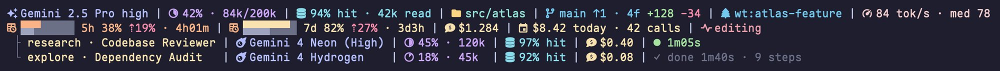
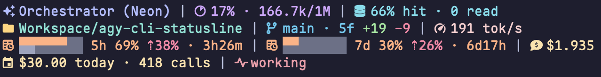

# agy-cli-statusline

面向 Antigravity CLI（`agy`）的可定制状态栏与终端实时预览编辑器。


[English](./README.md) · **简体中文**

## 效果预览


*完整布局：包含上下文圆环、缓存命中率、Git 变更统计、工作树、生成速率、5h/7d 配额速率条、会话/今日费用与列对齐的子代理树。*


*在较窄终端的 `agy` 实时会话中，超出宽度的状态栏会自动折行并保持完整样式。*

## 特性

- **多标签实时预览 TUI 工作室**：支持中英文切换，参考 CCometixLine 设计，提供 **预设** 卡片画廊（卡片实时渲染、`✓ 使用中` 状态标记、标签筛选、仅应用布局/样式及保存自定义预设）、**布局** 编排、**样式** 面板，以及底部支持场景切换、宽度标尺和模拟色深/图标集的 **实时预览** 栏。
- **丰富的指标组件**：内置 18 个组件，覆盖模型、上下文圆环/进度条、提示缓存、Git 变更统计、5h/7d 配额速率、生成速率、会话与今日花费以及列对齐的子代理树。
- **预设与主题**：提供 13 套预设（8 套 CCometixLine 预设 + 5 套内置预设）及自定义预设保存、18 套配色、Nerd / Unicode / ASCII 图标，以及**人为多行 + 窄终端行内自动无损折行**融合布局。
- **零依赖且安全安装**：无第三方运行时依赖；自动注册到 `~/.gemini/antigravity-cli/settings.json`，替换已有状态栏前会先询问并备份原配置。

## 快速开始

需要 **Node.js 22+**，以及 **macOS** 或 **Linux** 上的 **Antigravity CLI**。

### 交互式编辑器（推荐）

```sh
npx agy-cli-statusline
# 或在克隆的仓库目录运行：
node bin/agy-cli-statusline.mjs
```

选择 **English** 或 **简体中文**，在实时预览中调整预设、配色与组件，按 `Ctrl+S` 保存后重启 `agy` 即可生效。首次运行会自动注册状态栏（若检测到已有其他 `statusLine`，会先确认并备份 `settings.json`）。

### 在 `agy` 中以插件方式配置

```sh
agy plugin install https://github.com/Caph-dev/agy-cli-statusline
# 或在克隆的仓库目录安装：
agy plugin install .
```

在 `agy` 中输入 `/agy-cli-statusline-setup`，按 `Tab` 补全为 `/agy-cli-statusline:agy-cli-statusline-setup`（agy 1.5.18 要求使用完整命名空间），再告诉它想要的预设或组件即可。如果当前会话的状态栏未刷新，请重启 `agy`。

### 命令行与脚本配置

```sh
agy-cli-statusline configure --show
agy-cli-statusline configure --preset dashboard --color-depth 256
agy-cli-statusline configure --preset studio --segments "model,dir,git / context,cache,cost"
agy-cli-statusline configure --preset studio --layout 3,2 --segments "model,dir,git,context,cost"
agy-cli-statusline preview --preset cometix
```

在 `--segments` 中用 `/` 强制换行（行内可用 `|` 划分左右对齐），或直接通过 `--layout flat | preset | L[:R],L[:R]...` 指定行布局。运行 `agy-cli-statusline --help` 查看全部参数；如需直接替换已有自定义状态栏，请附加 `--replace`。

> 配置与独立渲染器副本保存在 `~/.gemini/antigravity-cli/agy-cli-statusline/`，清理 npm 缓存或卸载插件后状态栏仍可正常运行。如果终端未使用 Nerd Font，可将图标切换为 `unicode` 或 `ascii`。

## 内置组件

| 组件 ID | 名称 | 简介 |
| :--- | :--- | :--- |
| `model` | 模型 | 显示当前模型名称、ID 与推理强度。 |
| `dir` | 目录 | 工作区目录路径，支持 `auto`、`name`、`parent`、`tilde`、`short`、`full` 样式。 |
| `git` | Git | 分支、短 HEAD SHA、脏状态与领先/落后提交数，支持可选改动文件数与 `+新增 -删除` 行数统计。 |
| `worktree` | 工作树 | 关联的 Git worktree 名称。 |
| `vcs` | 版本控制 | 版本控制系统类型（在 `agy` 上报时显示）。 |
| `context` | 上下文 | 上下文窗口用量；默认动态按比例填充圆环（`gauge`，≥70% 标黄、≥90% 标红），也支持 `bar` / `text` 组件与用量格式（`% · used/total`）。 |
| `cache` | 缓存 | 提示缓存暖/冷 TTL 倒计时、会话命中率（`{hit}% hit`）、未命中次数与原因、冷缓存重建估算费用；支持 `text` / `bar` / `gauge` 组件。 |
| `tps` | 生成速度 | 最近一次模型调用的生成速率（`tok/s`），支持可选首字延迟与模型中位数。 |
| `quota` | 配额 | 汇总已上报配额窗口及最近重置倒计时。 |
| `quota.5h` | 5 小时配额 | 5 小时配额窗口，支持速率差值（`⇡` / `⇣`）、重置倒计时与 `pace` / `bar` / `gauge` / `text` 组件。 |
| `quota.7d` | 7 天配额 | 7 天（每周）配额窗口，支持速率差值（`⇡` / `⇣`）、重置倒计时与 `pace` / `bar` / `gauge` / `text` 组件。 |
| `quota.eta` | 配额耗尽时间 | 按当前消耗速率估算的配额耗尽剩余时间。 |
| `cost` | 费用 | 当前会话花费（`agy` 未提供时自动回退为本机对话库估算费用）。 |
| `cost.today` | 今日费用 | 本地 0 点起按 API 标准价估算的今日累计花费及调用/对话数。 |
| `state` | 代理 | 代理当前运行状态（如 `working`、`editing`、`idle`）。 |
| `subagents` | 子代理 | 展示活跃及近期子代理的列对齐树形列表 `tree`（最多 4 行，含模型、上下文、缓存、花费与实时状态，已完成约 10 秒后收起），也可切换为单行 `inline` 汇总。 |
| `cycle` | 循环 | 代理循环模式。 |
| `sandbox` | 沙箱 | 沙箱启用状态（`on` / `off`）。 |

- 编辑器使用示例数据预览全部指标；在 `agy` 实时会话中，没有数据的组件会自动隐藏。
- 当 `agy` 未直接提供对应字段时，`cache`、`tps`、`cost.today`、`cost` 与 `subagents` 会通过只读 `node:sqlite` 读取 `~/.gemini/antigravity-cli/conversations/*.db` 进行计算。

## 自定义与快捷键

- **预设**：CCometixLine 预设（`cometix`、`minimal`、`dashboard`、`budget`、`cache-aware`、`focus`、`zen`、`powerline`）与内置预设（`studio`、`signal`、`compact`、`bracket`、`focus-legacy`）。
- **配色与外观**：13 套 CCometixLine 配色 + 5 套内置主题（`dusk`、`ink`、`paper`、`signal`、`mono`）；支持 `powerline`、`plain`、`compact`、`bracket`、`pill` 样式及 `auto`、`truecolor`、`256`、`16`、`none` 色深。
- **人为多行 + 自动折行融合**：主面板**布局**支持在单行自动折行、预设多行与自定义多行之间切换；13 套预设均可自由指定强制换行和左右对齐，且每行超宽时仍各自独立无损折行。
- **单区块微调**：在布局编辑器中可为每个已启用区块单独调整组件形态、Nerd Font 备选图标或自定义字符，以及 `{field}` / `[...]` 模板。

| 按键 | 功能 |
| :--- | :--- |
| `←` / `→`（标签栏） | 在 **预设**、**布局**、**样式** 页面间切换（`↓` 进入页面，`Esc` / `↑` 返回标签栏） |
| **预设**：`←→↑↓` / `Tab` | 浏览预设卡片并切换筛选标签（`全部`、`我的`、`极简`、`多行`、`Powerline`、`配额`、`缓存`、`上下文`） |
| **预设**：`Enter` / `L` / `S` | 应用完整预设 / 仅应用布局 / 仅应用外观样式 |
| **预设**：`N` / `W` / `E` / `X` | 将当前配置另存为预设 / 覆盖 / 重命名 / 删除自定义预设 |
| **布局**：`↑↓` / `空格` / `Enter` | 选择区块 / 开关区块 / 拿起并移动顺序（移动中按 `Esc` 撤销） |
| **布局**：`b` / `a` / `m` / `e` / `r` | 强制换行或合并（`b`）、切换左右对齐（`a`）、切换布局模式（`m`）、编辑组件/图标/模板（`e`）、重置（`r`） |
| **样式**：`↑↓` / `←→` | 调整配色（带色块预览）、样式、图标、色深、上下文格式、配额估算、目录样式与布局模式 |
| **实时预览**：`[` `]` / `-` `+` / `{` `}` | 切换示例会话场景、调整预览宽度与标尺、模拟不同色深（`{`）与图标集（`}`） |
| 全局：`^Z` `^Y` / `^P` / `?` / `^S` / `q` | 撤销/重做 / 命令面板 / 快捷键帮助 / 保存 / 取消退出 |

## 致谢

- [CCometixLine](https://github.com/Haleclipse/CCometixLine)（Haleclipse）—— 提供了预设方案、调色板、ANSI 色彩转换及提示缓存指标设计。
- [agy-zh-pack](https://github.com/ncdeng/agy-zh-pack)（ncdeng）—— 提供了本机 SQLite / protobuf 遥测读取、API 价格表、TPS 与今日费用估算、缓存未命中检测及多行对齐子代理树组件。

上游具体提交哈希与 MIT 许可证原文见 [THIRD_PARTY_NOTICES.md](./THIRD_PARTY_NOTICES.md)。
